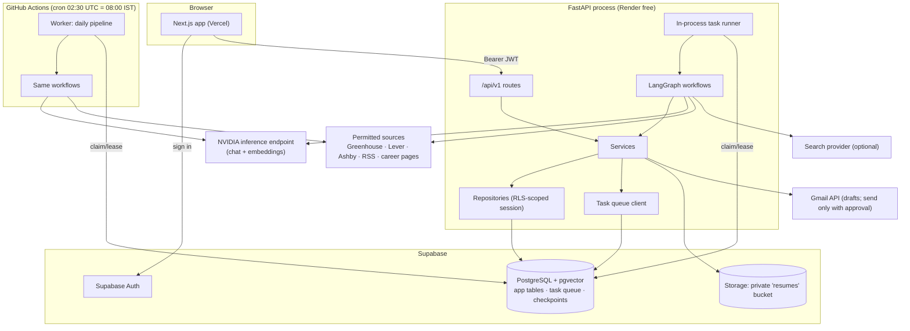

# CareerPilot AI — Architecture

Related: `PRD.md` (requirements, decisions D1–D15), `DATABASE_SCHEMA.md`, `API_SPEC.md`, `AGENT_DESIGN.md`, `SECURITY.md`, `DEPLOYMENT.md`.

---

## 1. Style

A **modular monolith**: one FastAPI codebase with independently testable modules, run as two kinds of process.

1. **API process.** FastAPI plus an in-process task runner that drains the durable task queue.
2. **Worker process.** The same codebase started as `python -m app.scheduler.daily`, run by GitHub Actions on a cron. It executes the daily pipeline and drains leftover tasks.

There are no microservices. Both processes share one PostgreSQL database (Supabase), which holds application data, vectors (pgvector), the task queue, and LangGraph checkpoints.

---

## 2. System diagram



---

## 3. Backend layering

```
api/v1 (routes)  →  services  →  repositories  →  SQLAlchemy models  →  Postgres
                       ↑    ↘
                 graphs/agents  integrations (llm, embeddings, storage, fetch, search, gmail, sources)
```

| Layer | Responsibility | Must not |
|---|---|---|
| `api/v1` | HTTP: auth dependency, request/response schemas, status codes, idempotency, rate limits | Contain business logic or touch the DB directly |
| `services` | Use cases: analyse a job, upload a resume, approve an action. Own transactions. | Import FastAPI types |
| `repositories` | All SQL. Every query on a user-owned table takes `user_id`. | Call external services |
| `graphs` | LangGraph `StateGraph` definitions: typed state, nodes, edges | Hold SQL; nodes call services |
| `agents` | LLM-backed node functions: render prompt → call LLM → validate | Have tools that write externally (`SECURITY.md` §5) |
| `domain` | Pure deterministic logic: scoring, dedup, normalisation, evidence verification, claim checks | Do any I/O. Fully unit-testable. |
| `integrations` | Provider adapters behind protocols (LLM, embeddings, storage, fetcher, search, Gmail, job sources) | Leak provider types upward |
| `tasks` | Durable queue: enqueue, claim, lease, retry, dead-letter. Task-type → handler registry. | — |
| `core` | Settings, logging, errors, security (JWT), DB session factory | — |

---

## 4. Request lifecycle and RLS enforcement

For each authenticated request:

1. The `get_current_user` dependency verifies the Supabase JWT (JWKS, issuer, audience, expiry) and upserts `users`.
2. The `get_user_session` dependency opens a transaction and runs:
   ```sql
   SET LOCAL ROLE authenticated;
   SELECT set_config('request.jwt.claims', :claims_json, true);  -- {"sub": "<uid>", "role": "authenticated"}
   ```
   Within this transaction, RLS policies `user_id = auth.uid()` apply, even though the backend's login role could bypass them.
3. Repositories also filter by `user_id` explicitly (defence in depth, clearer query plans).
4. The transaction commits or rolls back at the end of the request.

**System sessions** (the task runner claiming tasks across users, migrations, the taxonomy seed) use the login role without `SET ROLE`. Before a handler touches user data it opens a user-scoped session for the task's `user_id`. That keeps the same RLS guarantees inside workers.

Local Postgres has no Supabase `auth` schema. Migration `0001_supabase_compat` creates `authenticated`, `anon`, and `auth.uid()` only if they are missing, so the same policies run locally and in CI (`DATABASE_SCHEMA.md` §2).

---

## 5. Asynchronous work: durable task queue

Long operations (analyse a job, parse a resume, match, people discovery, outreach, discovery, export) are tasks, not in-request work.

```mermaid
sequenceDiagram
    participant UI
    participant API
    participant DB as Postgres
    participant TR as Task runner
    participant G as LangGraph workflow
    UI->>API: POST /api/v1/jobs/analyze (Idempotency-Key)
    API->>DB: insert job(status=analyzing), agent_run(queued), scheduled_task(queued)
    API-->>UI: 202 {workflow_id, job_id, status_url}
    TR->>DB: claim task (FOR UPDATE SKIP LOCKED, lease 5 min)
    TR->>G: run job_extraction graph (thread_id = agent_run.id)
    G->>DB: progress per node → agent_runs.progress
    loop every 2s
      UI->>API: GET /api/v1/agent-runs/{id}
      API-->>UI: {status, current_node, progress}
    end
    G->>DB: persist job + skills + evidence; enqueue match_resumes task
    TR->>DB: task completed, agent_run completed
```

**Queue semantics** (`scheduled_tasks` table)

- **Claim:**
  ```sql
  UPDATE scheduled_tasks SET status='running', locked_by=:worker, locked_until=now()+:lease, attempts=attempts+1
  WHERE id = (SELECT id FROM scheduled_tasks
              WHERE status='queued' AND run_after <= now()
              ORDER BY priority, run_after
              FOR UPDATE SKIP LOCKED LIMIT 1)
  RETURNING *
  ```
- **Lease renewal:** a heartbeat every lease/3. A crashed or slept process stops heartbeating, and its task becomes claimable again once `locked_until < now()` (a sweeper re-queues it).
- **Retry:** transient errors re-queue with `run_after = now() + base·2^attempts` (base 30 s, jitter ±20 %), up to `max_attempts` (default 3), after which the task is `dead`. Non-transient errors (validation, permission) fail immediately.
- **Idempotency:** `idempotency_key` is unique. The daily trigger uses `daily_pipeline:{user_id}:{YYYY-MM-DD}`, so re-running the cron the same day reuses the existing task.
- **Concurrency:** the API runner processes `TASK_RUNNER_CONCURRENCY` tasks at once (default 2), to stay inside free-tier memory and LLM rate limits. LLM calls also go through a process-wide semaphore.
- **Manual rerun:** `POST /agent-runs/{id}/retry` re-queues a failed or dead task with a new attempt budget.

Each task has one `agent_runs` row (the workflow ID the UI polls). A LangGraph `thread_id` equals the `agent_runs.id`, so Phase 4 checkpoints line up with runs.

---

## 6. Workflows (LangGraph)

Separate graphs with typed state, no "giant agent". Full detail is in `AGENT_DESIGN.md`.

| Graph | Trigger | Phase |
|---|---|---|
| `resume_ingestion` | resume upload | 1 |
| `job_extraction` | analyze / analyze-url / analyze-file / discovery | 1 |
| `resume_matching` | after extraction; `POST /resumes/match/{job_id}` | 1 |
| `people_discovery` | "Find people"; daily pipeline for priority jobs | 2 |
| `job_discovery` | `POST /jobs/discover`; daily pipeline | 2 |
| `outreach_generation` | "Generate outreach"; daily pipeline (optional) | 3 |
| `resume_optimization` | "Suggest improvements" | 3 |
| `application_preparation` | "Prepare application" | 5 |
| `approval` (subgraph pattern) | any gated action | 3–5 |

Ranking is a deterministic **service** (`domain/ranking.py`), called as a node, not a graph of its own.

**Checkpointing.** Phase 1 compiles graphs with LangGraph's in-memory checkpointer; durability comes from task retry, since nodes are idempotent upserts. Phase 4 switches to `AsyncPostgresSaver` (schema `langgraph`) so a run resumes from its last completed node and can pause at `interrupt()` for approval.

---

## 7. LLM and embedding layer

```
agents/*  →  llm.structured(prompt_ref, variables, OutputModel)  →  provider (ChatNVIDIA via LangChain)
```

- **Provider abstraction.** The `LLMClient` protocol has `structured(...)` and `text(...)`. `NvidiaLLMClient` uses `langchain-nvidia-ai-endpoints` `ChatNVIDIA(model=NVIDIA_MODEL, base_url=NVIDIA_BASE_URL)`. A `FakeLLMClient` serves fixture responses in tests only and can't be selected when `APP_ENV=production`.
- **Prompt registry.** `backend/app/prompts/<prompt_id>/v<N>.yaml` (system, user template, schema reference, changelog). The prompt ID and version are recorded on every call (spec §13.8).
- **Structured output.** `LLM_STRUCTURED_OUTPUT_MODE=auto` uses the provider's native JSON-schema or tool-calling mode if `scripts/check_llm.py` confirmed the model supports it. Otherwise it uses a JSON-in-prompt mode. In both modes:
  1. strip any `<think>…</think>` reasoning block;
  2. parse JSON;
  3. validate with Pydantic;
  4. on failure, make **one** repair call carrying the validation errors (no new external content);
  5. then fail the node with `invalid_llm_output`.
- **Untrusted content.** External text is passed only inside `<untrusted_document id="…">…</untrusted_document>` delimiters, after the system prompt says it is data (`SECURITY.md` §5).
- **Caching.** `input_hash = sha256(model_id, prompt_id, prompt_version, canonical variables)`. A successful `llm_calls` row with the same hash is reused (`status=cache_hit`). This also makes outputs reproducible.
- **Budgets.** `LLM_DAILY_CALL_BUDGET` per user. Once exhausted, new LLM tasks stay `queued` with `run_after` set to the next day, and the UI shows "LLM quota reached — queued".
- **Retries.** HTTP 429, 5xx, and timeouts retry with exponential backoff (`LLM_MAX_RETRIES`). Other errors don't.
- **Embeddings.** `EmbeddingClient` → `NVIDIAEmbeddings(model=NVIDIA_EMBEDDING_MODEL)`, using `input_type=passage` for resume chunks and `query` for job requirements. The vector dimension is fixed by migration (`EMBEDDING_DIMENSIONS`, default 1024). Changing the model means a migration plus re-embedding (`scripts/reembed.py`).

---

## 8. External content: fetching and sources

**`SafeFetcher`** (`integrations/fetch.py`) is the only outbound HTTP client for untrusted URLs:

- http/https only;
- DNS resolved and private, loopback, link-local, and metadata IPs rejected, re-checked on every redirect (max 5);
- 15 s timeout and a 2 MB body cap;
- content-type allowlist;
- robots.txt honoured (cached 24 h) with User-Agent `CareerPilotBot/1.0 (+<contact URL>)`;
- per-domain token-bucket rate limit;
- blocked-host list (`linkedin.com`, `*.linkedin.com`, plus configurable entries) for which fetching is refused with `source_not_permitted`.

**Job source adapters** (`integrations/sources/`) implement the spec §4.5 contract. Their documented JSON APIs are called with the same rate limiting and UA. `discover()` returns `NormalizedListing`s. `fetch_details()` fills the description when a list endpoint omits it. `health_check()` reports reachability and last error.

**Parsing.** HTML goes through BeautifulSoup (`lxml`): scripts, styles, nav, and footer are removed, and JSON-LD `JobPosting` is preferred when present. PDF uses PyMuPDF, DOCX uses python-docx. Playwright is optional: it is only allowed for allowlisted career-page domains that need JS rendering and is not installed in the API image (memory). See `DEPLOYMENT.md` §4.

---

## 9. Frontend architecture

- Next.js (App Router) + TypeScript, Tailwind CSS, shadcn/ui; pnpm.
- **Auth:** `@supabase/ssr` for sign-in and session refresh only. The browser never queries tables directly. Every data call goes to FastAPI with `Authorization: Bearer <access_token>`.
- **Data:** TanStack Query, with a typed API client generated from FastAPI's OpenAPI document (`openapi-typescript`) so frontend and backend types can't drift.
- **Workflow progress:** the `useAgentRun(id)` hook polls every 2 s while the run is non-terminal and backs off after 2 min.
- **Routes:** `/dashboard`, `/jobs`, `/jobs/[id]`, `/resumes`, `/resumes/[id]`, `/people`, `/outreach`, `/applications`, `/settings/*`, `/login`, `/auth/callback`.
- **Rules:** no `dangerouslySetInnerHTML` on external content; estimated, inferred, and unverified values use distinct badge components (`<ProvenanceBadge kind="explicit|inferred|estimate|unverified">`).

---

## 10. Cross-cutting concerns

| Concern | Approach |
|---|---|
| Config | `pydantic-settings` `Settings`, validated at startup; fails fast on missing required vars for the active `APP_ENV`. |
| Logging | `structlog` JSON: `request_id`, `user_id` (UUID only), `workflow_id`, `task_id`, `node`. A redaction processor masks emails, phone numbers, tokens, and API keys. |
| Errors | Domain exceptions (`NotFound`, `Conflict`, `SourceNotPermitted`, `ApprovalRequired`, `LLMUnavailable`, …) map to the error envelope in `API_SPEC.md` §1.3. Unhandled exceptions return `internal_error` with the `request_id`. |
| Time | Stored as UTC `timestamptz`; displayed in the user's timezone (default Asia/Kolkata). |
| Rate limiting | Per-user token buckets (in-process; single API instance — see `DEPLOYMENT.md` §4). |
| Audit | `audit_events` rows for auth-sensitive and external actions (`SECURITY.md` §8). |
| Health | `GET /api/v1/health` (liveness + DB ping + migration version). |

---

## 11. Testing strategy

| Level | Scope | Tooling |
|---|---|---|
| Unit | `domain/*` (scoring, dedup, URL canonicalisation, evidence verification, claim checks, salary/experience normalisation), schema validation, prompt rendering | pytest, hypothesis for normalisers |
| Integration | API + real Postgres (pgvector) + migrations + RLS; FakeLLM fixtures; local storage | pytest + httpx `AsyncClient`, a per-test transaction or per-session database |
| Adapter contract | Each source adapter against recorded responses (VCR-style cassettes, no live calls in CI) | pytest + respx |
| Isolation | Two users; every endpoint checked for cross-user `404`; raw SQL checks that RLS blocks cross-user reads | pytest |
| Frontend | Component tests (Vitest + Testing Library); Playwright e2e smoke on critical flows | Vitest, Playwright |
| Evaluation | Real LLM against a labelled dataset; reports metrics, never runs in CI by default | `python -m evals.run <suite>` |

---

## 12. Repository structure

```text
careerpilot-ai/
├── README.md
├── .env.example                      # every variable, no values (see DEPLOYMENT.md §9)
├── .gitignore
├── .github/
│   └── workflows/
│       ├── ci.yml                    # lint, typecheck, tests (backend + frontend), secret scan
│       └── daily-discovery.yml       # cron 30 2 * * * → python -m app.scheduler.daily
├── docs/
│   ├── SPECIFICATION.md              # original spec, unchanged
│   ├── PRD.md
│   ├── ARCHITECTURE.md
│   ├── DATABASE_SCHEMA.md
│   ├── API_SPEC.md
│   ├── AGENT_DESIGN.md
│   ├── SECURITY.md
│   ├── DEPLOYMENT.md
│   └── IMPLEMENTATION_PLAN.md
├── backend/
│   ├── pyproject.toml                # uv-managed; Python 3.12
│   ├── uv.lock
│   ├── requirements.txt              # exported from uv.lock for Docker/hosts
│   ├── Dockerfile
│   ├── docker-entrypoint.sh          # alembic upgrade head (advisory lock) → uvicorn
│   ├── alembic.ini
│   ├── alembic/
│   │   ├── env.py
│   │   └── versions/
│   ├── app/
│   │   ├── main.py                   # app factory, middleware, router mount, task runner lifespan
│   │   ├── api/
│   │   │   ├── deps.py               # auth, user session, pagination, idempotency
│   │   │   └── v1/
│   │   │       ├── router.py
│   │   │       ├── jobs.py
│   │   │       ├── resumes.py
│   │   │       ├── people.py
│   │   │       ├── outreach.py
│   │   │       ├── applications.py
│   │   │       ├── profile.py
│   │   │       ├── search_configs.py
│   │   │       ├── sources.py
│   │   │       ├── approvals.py
│   │   │       ├── integrations.py   # Google OAuth
│   │   │       ├── dashboard.py
│   │   │       ├── scheduler.py
│   │   │       ├── agent_runs.py
│   │   │       ├── notifications.py
│   │   │       ├── account.py        # export / delete
│   │   │       └── health.py
│   │   ├── core/
│   │   │   ├── config.py
│   │   │   ├── logging.py
│   │   │   ├── errors.py
│   │   │   ├── security.py           # JWT verification, dev-auth guard
│   │   │   ├── db.py                 # engine, system + user-scoped sessions
│   │   │   └── crypto.py             # MultiFernet token encryption
│   │   ├── models/                   # SQLAlchemy ORM, one module per aggregate
│   │   ├── schemas/                  # Pydantic API + LLM output schemas
│   │   │   ├── api/
│   │   │   └── llm/
│   │   ├── repositories/
│   │   ├── services/
│   │   ├── domain/                   # pure deterministic logic
│   │   │   ├── skills.py             # taxonomy normalisation
│   │   │   ├── evidence.py           # snippet verification
│   │   │   ├── matching.py           # K, P, E_rel, R, D
│   │   │   ├── ranking.py            # M, F, E_elig, L, S, bands, disqualifiers
│   │   │   ├── people_scoring.py
│   │   │   ├── dedup.py
│   │   │   ├── urls.py               # canonicalisation, LinkedIn URL normalisation
│   │   │   ├── claims.py             # outreach / resume claim validation
│   │   │   └── text.py               # cleaning, hashing, chunking
│   │   ├── agents/                   # LLM node functions (switch to heuristics/ when LLM_PROVIDER=none)
│   │   ├── heuristics/               # deterministic rule-based agents (D16)
│   │   ├── graphs/                   # LangGraph StateGraphs + typed states
│   │   ├── integrations/
│   │   │   ├── llm/                  # protocol, nvidia, fake
│   │   │   ├── embeddings/
│   │   │   ├── storage/              # supabase, local
│   │   │   ├── fetch.py              # SafeFetcher
│   │   │   ├── parsing/              # html, pdf, docx
│   │   │   ├── search/               # protocol, brave, tavily, google_cse, none
│   │   │   ├── gmail.py
│   │   │   └── sources/              # greenhouse, lever, ashby, rss, career_page, manual
│   │   ├── tasks/                    # queue, runner, registry, handlers
│   │   ├── scheduler/
│   │   │   └── daily.py              # worker entry point
│   │   ├── prompts/                  # versioned YAML prompts (spec §13.8)
│   │   ├── data/
│   │   │   ├── skills_taxonomy.yaml
│   │   │   └── scoring_config.yaml   # weights, thresholds, versioned
│   │   └── utils/
│   ├── scripts/
│   │   ├── check_llm.py              # lists models, verifies structured output support
│   │   ├── seed.py                   # taxonomy + default search config
│   │   └── reembed.py
│   ├── evals/
│   │   ├── datasets/
│   │   ├── run.py
│   │   └── results/                  # gitignored except summaries
│   └── tests/
│       ├── unit/
│       ├── integration/
│       ├── contract/                 # adapter cassettes
│       └── fixtures/                 # sample JDs/resumes — synthetic, labelled as such
└── frontend/
    ├── package.json
    ├── pnpm-lock.yaml
    ├── next.config.ts
    ├── components.json               # shadcn/ui
    ├── app/
    │   ├── (auth)/login/
    │   ├── auth/callback/
    │   ├── dashboard/
    │   ├── jobs/  [id]/
    │   ├── resumes/  [id]/
    │   ├── people/
    │   ├── outreach/
    │   ├── applications/
    │   └── settings/
    ├── components/
    │   ├── ui/                       # shadcn primitives
    │   └── …                         # ProvenanceBadge, EvidencePopover, RunProgress, ApprovalDialog
    ├── hooks/                        # useAgentRun, useApi
    ├── lib/                          # api client, supabase client, formatters (IST display)
    ├── types/                        # generated OpenAPI types
    └── tests/
```

---

## 13. Free-tier constraints and degraded modes

| Constraint | Effect | Mitigation |
|---|---|---|
| The API host sleeps when idle | Tasks pause; first request is slow | Leased tasks resume after wake; the daily pipeline runs in GitHub Actions, not on the API host |
| ~512 MB RAM on free hosts | No Playwright or large models in the API | Remote embeddings; Playwright optional, worker-only |
| LLM free quota and rate limits | Analysis can stall | Daily budget, caching, deterministic pre-filtering, queue-and-wait degraded mode |
| Search API quota | Fewer contacts | Per-day query budget; company pages and user URLs still work |
| Supabase free project pauses after inactivity | DB offline | The daily run keeps it active; documented restore step |
| GitHub Actions cron delays | Daily run may start late | The run is idempotent per day; it doesn't depend on exact timing (spec §10.1) |

Provider limits change. `DEPLOYMENT.md` §8 lists everything that must be re-checked right before deployment.
