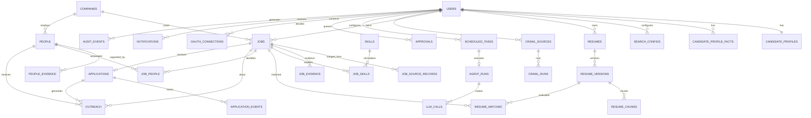

# CareerPilot AI — Database Schema

PostgreSQL 15+ (Supabase), with the `pgvector` and `pgcrypto` extensions. Alembic owns the schema. The DDL below is the design target the migrations implement; Alembic migrations are the executable source.

---

## 1. Conventions

- **Primary keys:** `id uuid PRIMARY KEY DEFAULT gen_random_uuid()`.
- **Timestamps:** `created_at timestamptz NOT NULL DEFAULT now()`. Mutable tables also have `updated_at timestamptz NOT NULL DEFAULT now()`, maintained by trigger `set_updated_at()`. All times are UTC.
- **Enumerations:** `text` plus a named `CHECK` constraint (`ck_<table>_<column>`), not Postgres `ENUM`, so values can be added in a migration without type rewrites. Allowed values are listed inline as `{a|b|c}`.
- **Ownership:** every user-owned table has `user_id uuid NOT NULL REFERENCES users(id) ON DELETE CASCADE`, plus RLS (§5).
- **Money:** `numeric(14,2)`. Years: `numeric(4,1)`.
- **Evidence:** short verbatim snippets (≤ 500 chars) from the source text, verified deterministically (`AGENT_DESIGN.md` §3.3).
- **Delete behaviour:** child rows of a user-owned aggregate cascade. References to shared tables (`companies`, `skills`) are `ON DELETE RESTRICT`. Optional cross-links (e.g. `outreach.person_id`) are `ON DELETE SET NULL`.

---

## 2. Supabase compatibility (migration `0001_supabase_compat`)

Supabase provides the roles `anon`, `authenticated`, `service_role` and the function `auth.uid()`. Plain Postgres (local, CI) does not. The first migration creates them **only if absent**:

```sql
CREATE EXTENSION IF NOT EXISTS pgcrypto;
CREATE EXTENSION IF NOT EXISTS vector;
DO $$ BEGIN
  IF NOT EXISTS (SELECT 1 FROM pg_roles WHERE rolname='authenticated') THEN CREATE ROLE authenticated NOLOGIN; END IF;
  IF NOT EXISTS (SELECT 1 FROM pg_roles WHERE rolname='anon') THEN CREATE ROLE anon NOLOGIN; END IF;
END $$;
CREATE SCHEMA IF NOT EXISTS auth;
-- Only created if missing; Supabase already defines it identically.
CREATE OR REPLACE FUNCTION auth.uid() RETURNS uuid LANGUAGE sql STABLE AS $$
  SELECT nullif(current_setting('request.jwt.claims', true)::jsonb ->> 'sub', '')::uuid
$$;  -- guarded by an existence check in the migration
GRANT authenticated TO CURRENT_USER;   -- lets the backend login role SET ROLE authenticated
```

Grants: `authenticated` gets `SELECT, INSERT, UPDATE, DELETE` on user-owned tables and `SELECT` on shared tables. `anon` gets nothing. Because the frontend never queries tables directly, the Supabase Data API exposes nothing even if it is enabled. RLS with no `anon` policy denies everything.

---

## 3. Entity relationships



---

## 4. Tables

### 4.1 Identity and candidate

```sql
users (                                   -- id = Supabase auth.users.id (JWT sub)
  id uuid PRIMARY KEY,                    -- no default: comes from the JWT
  email text NOT NULL UNIQUE,
  display_name text,
  timezone text NOT NULL DEFAULT 'Asia/Kolkata',
  settings jsonb NOT NULL DEFAULT '{}',   -- scheduler time, notification prefs, scoring overrides
  created_at, updated_at
)

candidate_profiles (
  id, user_id UNIQUE,
  full_name text, preferred_email text,
  phone text,                             -- optional, sensitive (never sent to LLM by default)
  current_location text,
  preferred_locations text[] NOT NULL DEFAULT '{}',
  preferred_work_modes text[] NOT NULL DEFAULT '{}',     -- {remote|hybrid|onsite}
  graduation_year int,
  total_experience_months int,
  preferred_roles text[] NOT NULL DEFAULT '{}',
  preferred_industries text[] NOT NULL DEFAULT '{}',
  portfolio_url text, github_url text, linkedin_url text,
  salary_preference jsonb,                -- {minimum, currency, period}
  employment_type_preferences text[] NOT NULL DEFAULT '{}',
  notice_period_days int,
  work_authorization text,                -- optional, sensitive, user-supplied only
  field_sources jsonb NOT NULL DEFAULT '{}',  -- {field_name: user_entered|resume_derived|inferred}
  created_at, updated_at
)

candidate_profile_facts (                 -- list-type facts with provenance (FR-PROF-03)
  id, user_id,
  fact_type text NOT NULL,                -- {education|project|experience|certification|achievement|skill}
  data jsonb NOT NULL,                    -- shape per fact_type (schemas/api/profile.py)
                                          -- skill: {skill_id, name, has_skill: true|false, level?}
  source text NOT NULL,                   -- {user_entered|resume_derived|inferred}
  source_resume_version_id uuid REFERENCES resume_versions(id) ON DELETE SET NULL,
  status text NOT NULL,                   -- {confirmed|suggested|rejected}
  dedup_key text NOT NULL,                -- prevents duplicate suggestions; suggestions never overwrite confirmed facts
  confirmed_at timestamptz,
  created_at, updated_at
)

search_configs (
  id, user_id,
  name text NOT NULL,
  role_filters text[] NOT NULL,           -- seeded from spec §3.3
  experience_bands jsonb NOT NULL,        -- [{label:"0–2 years", min:0, max:2}, {label:"Fresher", min:0, max:0}, …]
  locations text[] NOT NULL,
  work_modes text[] NOT NULL DEFAULT '{}',
  skills text[] NOT NULL,
  salary_minimum numeric(14,2), salary_currency text, salary_period text,
  is_active boolean NOT NULL DEFAULT true,
  created_at, updated_at
)
```

### 4.2 Shared reference data (no `user_id`)

```sql
companies (
  id, name text NOT NULL,
  normalized_name text NOT NULL UNIQUE,   -- lowercased, legal suffixes stripped (Pvt Ltd, Inc, …)
  domain text UNIQUE,                     -- registrable domain, e.g. example.com
  website text, careers_url text,
  created_at, updated_at
)

skills (                                  -- taxonomy, seeded from app/data/skills_taxonomy.yaml
  id, canonical_name text NOT NULL UNIQUE,     -- e.g. "PostgreSQL"
  slug text NOT NULL UNIQUE,                   -- "postgresql"
  category text NOT NULL,   -- {programming_languages|frameworks_libraries|ai_ml|llm_engineering|
                            --  retrieval_vector_db|databases|cloud|devops_infra|data_engineering|
                            --  system_design|domain_knowledge|soft_skills}
  aliases text[] NOT NULL DEFAULT '{}',        -- normalised: {"postgres","psql","postgre sql"}
  parent_id uuid REFERENCES skills(id),        -- e.g. "LangGraph" → parent "LangChain ecosystem" (no double count)
  created_at, updated_at
)
```

Writes to shared tables happen only in system sessions (the backend upserts companies discovered during extraction). `authenticated` has `SELECT` only.

### 4.3 Resumes

```sql
resumes (                                 -- logical resume ("GenAI / LLM Engineer")
  id, user_id,
  label text NOT NULL, label_suggested text,
  category text,                          -- free text, suggested from content
  is_default boolean NOT NULL DEFAULT false,   -- partial unique: one default per user
  status text NOT NULL,                   -- {uploaded|parsing|parsed|needs_review|failed}
  current_version_id uuid,                -- FK → resume_versions(id), DEFERRABLE
  created_at, updated_at
)

resume_versions (                         -- immutable file + parse output (FR-RES-02, FR-RES-13)
  id, user_id,
  resume_id uuid NOT NULL REFERENCES resumes(id) ON DELETE CASCADE,
  version_number int NOT NULL,            -- UNIQUE (resume_id, version_number)
  parent_version_id uuid REFERENCES resume_versions(id),
  storage_key text NOT NULL,              -- "<user_id>/<uuid>.pdf" in private bucket; never a public URL
  file_sha256 text NOT NULL, mime_type text NOT NULL, file_size_bytes int NOT NULL,
  original_filename text NOT NULL,
  page_count int,
  extracted_text text,                    -- plain text with section markers
  parsed_data jsonb,                      -- ResumeParsed schema (sections, skills, projects, experience, domains)
  parsed_data_origin text,                -- {llm|user_corrected}
  parse_warnings jsonb NOT NULL DEFAULT '[]',
  change_summary text,
  approval_status text NOT NULL,          -- {original|draft|pending_approval|approved|rejected}
  job_id uuid REFERENCES jobs(id) ON DELETE SET NULL,     -- set when tailored for a job
  approval_id uuid REFERENCES approvals(id),
  created_at
  -- trigger: storage_key, file_sha256, extracted_text are immutable after insert;
  --          rows with approval_status='original' cannot be deleted while the resume exists
)

resume_chunks (
  id, user_id,
  resume_version_id uuid NOT NULL REFERENCES resume_versions(id) ON DELETE CASCADE,
  section text NOT NULL,     -- {summary|skills|experience|project|education|certification|achievement|other}
  section_index int NOT NULL,             -- e.g. 2nd project
  item_ref text,                          -- stable key into parsed_data (e.g. "projects[1]")
  content text NOT NULL,                  -- ≤ ~1,200 chars; bullets kept whole
  content_sha256 text NOT NULL,
  page_number int,
  embedding vector(1024),                 -- dimension = EMBEDDING_DIMENSIONS at migration time
  embedding_model text,
  created_at
)
```

### 4.4 Jobs

```sql
jobs (
  id, user_id,
  company_id uuid REFERENCES companies(id) ON DELETE RESTRICT,
  input_type text NOT NULL,               -- {text|url|pdf|docx|manual|discovery}
  canonical_url text,                     -- normalised source URL (domain/urls.py)
  application_url text,
  title text, normalized_title text,
  department text,
  seniority text,                         -- {intern|graduate|junior|mid|senior|lead|principal|unknown}
  experience_min_years numeric(4,1), experience_max_years numeric(4,1),
  experience_explicit boolean NOT NULL DEFAULT false,
  experience_evidence text,
  locations jsonb NOT NULL DEFAULT '[]',  -- [{city, region, country, raw}]
  work_mode text NOT NULL DEFAULT 'unknown',        -- {remote|hybrid|onsite|unknown}
  employment_type text NOT NULL DEFAULT 'unknown',  -- {full_time|part_time|contract|internship|temporary|unknown}
  salary_min numeric(14,2), salary_max numeric(14,2),
  salary_currency text,                   -- ISO 4217
  salary_period text,                     -- {annual|monthly|hourly|unknown}
  salary_source_type text NOT NULL DEFAULT 'not_disclosed',  -- {jd|source_website|third_party_estimate|not_disclosed}
  salary_is_base boolean,                 -- null = unknown (base vs total comp)
  salary_source_url text, salary_retrieved_at timestamptz, salary_confidence numeric(3,2),
  education jsonb NOT NULL DEFAULT '[]',
  responsibilities jsonb NOT NULL DEFAULT '[]',
  technical_requirements jsonb NOT NULL DEFAULT '[]',
  soft_skills jsonb NOT NULL DEFAULT '[]',
  business_domain text,
  application_deadline date,
  posted_at timestamptz, posted_at_source text,     -- {source_api|page|jd_text|unknown}
  hiring_expectations text,
  description_text text NOT NULL,         -- cleaned text (no HTML); retained per §6
  description_sha256 text NOT NULL,       -- hash of normalised description
  extraction jsonb,                       -- full validated LLM output (JobExtraction schema)
  missing_information text[] NOT NULL DEFAULT '{}',
  field_confidence jsonb NOT NULL DEFAULT '{}',
  status text NOT NULL,                   -- {queued|analyzing|analyzed|failed|archived}
  saved boolean NOT NULL DEFAULT false,
  -- ranking (FR-RANK)
  best_resume_id uuid REFERENCES resumes(id) ON DELETE SET NULL,
  match_score numeric(5,2), job_score numeric(5,2),
  job_score_breakdown jsonb,              -- {M,F,E_elig,L,S, explanations, disqualifiers}
  priority text,                          -- {excellent|strong|moderate|low}
  scoring_config_version text,
  prompt_version text, model_id text, analyzed_at timestamptz,
  last_seen_at timestamptz,               -- last time any source still listed it
  created_at, updated_at
)

job_source_records (                      -- every listing/input merged into a canonical job (FR-DISC-04)
  id, user_id,
  job_id uuid NOT NULL REFERENCES jobs(id) ON DELETE CASCADE,
  crawl_source_id uuid REFERENCES crawl_sources(id) ON DELETE SET NULL,
  source_name text NOT NULL,              -- greenhouse|lever|ashby|rss|career_page|manual|user_paste
  source_listing_id text,
  source_url text, canonical_url text, application_url text,
  raw_title text, raw_company text, raw_location text,
  posted_at timestamptz,
  collected_at timestamptz NOT NULL,
  raw_description text,                   -- cleaned text; purged per §6
  content_sha256 text,
  dedup_signal text,                      -- {new|canonical_url|source_listing_id|application_url|content_hash|company_title_location}
  metadata jsonb NOT NULL DEFAULT '{}',   -- source-specific (department, office ids, compensation block, …)
  created_at
)

job_evidence (                            -- field-level provenance (FR-JOB-06)
  id, user_id,
  job_id uuid NOT NULL REFERENCES jobs(id) ON DELETE CASCADE,
  field text NOT NULL,                    -- "experience" | "salary" | "work_mode" | "location" | "deadline" | …
  value jsonb,
  evidence_text text,
  explicit boolean NOT NULL,              -- stated vs inferred (P3)
  verified boolean NOT NULL,              -- snippet found in source text
  confidence numeric(3,2),                -- model-reported; not proof
  source_record_id uuid REFERENCES job_source_records(id) ON DELETE SET NULL,
  created_at
)

job_skills (
  id, user_id,
  job_id uuid NOT NULL REFERENCES jobs(id) ON DELETE CASCADE,
  skill_id uuid REFERENCES skills(id) ON DELETE RESTRICT,  -- null if not in taxonomy
  raw_name text NOT NULL,
  normalized_name text NOT NULL,          -- canonical_name if mapped, else cleaned raw
  category text NOT NULL,
  importance text NOT NULL,               -- {mandatory|preferred|mentioned}
  evidence_text text, evidence_verified boolean NOT NULL DEFAULT false,
  confidence numeric(3,2),
  created_at
  -- UNIQUE (job_id, normalized_name)
)

resume_matches (
  id, user_id,
  job_id uuid NOT NULL REFERENCES jobs(id) ON DELETE CASCADE,
  resume_id uuid NOT NULL REFERENCES resumes(id) ON DELETE CASCADE,
  resume_version_id uuid NOT NULL REFERENCES resume_versions(id) ON DELETE CASCADE,
  score numeric(5,2) NOT NULL,
  components jsonb NOT NULL,              -- {K:{score,explanation,evidence_refs}, P:…, E_rel:…, R:…, D:…}
  mandatory_coverage numeric(5,2), preferred_coverage numeric(5,2),
  skill_breakdown jsonb NOT NULL,         -- [{skill, importance, status: strong|listed_only|profile_only|no_evidence|confirmed_missing, evidence_refs}]
  relevant_projects jsonb NOT NULL DEFAULT '[]',
  relevant_experience jsonb NOT NULL DEFAULT '[]',
  suggestions jsonb,                      -- LLM: summary, bullet rewrites (validated)
  explanation text,                       -- LLM prose; never alters numbers
  limitations jsonb NOT NULL DEFAULT '[]',
  rank int NOT NULL, is_best boolean NOT NULL,
  scoring_config_version text NOT NULL,
  input_hash text NOT NULL,               -- job content hash + resume version + config version
  created_at
  -- UNIQUE (job_id, resume_version_id, scoring_config_version)
)
```

### 4.5 People

```sql
people (
  id, user_id,
  company_id uuid REFERENCES companies(id) ON DELETE RESTRICT,
  name text NOT NULL, normalized_name text NOT NULL,
  designation text, department text,
  linkedin_url text,                      -- normalised https://www.linkedin.com/in/<slug>/
  public_email text,                      -- only if verbatim in evidence (FR-PPL-04)
  public_email_evidence_id uuid,          -- FK → people_evidence(id)
  association_status text NOT NULL,       -- {verified_current|likely_current|unverified}
  contact_status text NOT NULL DEFAULT 'new',  -- {new|contacted|responded|do_not_contact}
  added_by text NOT NULL,                 -- {discovery|user}
  notes text,
  first_discovered_at timestamptz NOT NULL, last_verified_at timestamptz,
  created_at, updated_at
  -- UNIQUE (user_id, linkedin_url) WHERE linkedin_url IS NOT NULL
)

people_evidence (
  id, user_id,
  person_id uuid REFERENCES people(id) ON DELETE CASCADE,   -- null until linked
  job_id uuid REFERENCES jobs(id) ON DELETE SET NULL,
  company_id uuid REFERENCES companies(id),
  source_type text NOT NULL,   -- {company_page|job_post|user_provided|search_result|conference|blog|directory}
  provider text,               -- search provider name or "fetch"/"user"
  source_url text NOT NULL, source_title text,
  snippet text NOT NULL,       -- verbatim text the classification relied on
  content_sha256 text NOT NULL,
  retrieved_at timestamptz NOT NULL,
  created_at
)

job_people (
  id, user_id,
  job_id uuid NOT NULL REFERENCES jobs(id) ON DELETE CASCADE,
  person_id uuid NOT NULL REFERENCES people(id) ON DELETE CASCADE,
  role_category text NOT NULL,  -- {job_poster|technical_recruiter|talent_acquisition|hr_recruiter|
                                --  hiring_manager|engineering_manager|team_lead|department_head|
                                --  senior_engineer|team_member|talent_partner|hr_business_partner|
                                --  alumni|technical_leader|other_employee}
  relevance_score numeric(5,2) NOT NULL,
  components jsonb NOT NULL,    -- {T,D,C,S}
  relevance_reason text NOT NULL,
  confidence numeric(3,2),
  evidence_ids uuid[] NOT NULL, -- ≥ 1 (CHECK cardinality(evidence_ids) > 0)
  rank int NOT NULL,
  created_at
  -- UNIQUE (job_id, person_id)
)
```

### 4.6 Outreach and applications

```sql
outreach (
  id, user_id,
  job_id uuid REFERENCES jobs(id) ON DELETE CASCADE,
  person_id uuid REFERENCES people(id) ON DELETE SET NULL,
  application_id uuid REFERENCES applications(id) ON DELETE SET NULL,
  message_type text NOT NULL,   -- {linkedin_connection|linkedin_follow_up|referral_request|
                                --  hiring_manager_message|recruiter_email|recruiter_follow_up|thank_you}
  channel text NOT NULL,        -- {linkedin|email}
  recipient_name text,
  recipient_email text,         -- must equal person.public_email or be null (enforced in service)
  subject text,                 -- email only
  body text NOT NULL,
  recommended_resume_id uuid REFERENCES resumes(id) ON DELETE SET NULL,
  personalization_evidence jsonb NOT NULL DEFAULT '[]',  -- [{id: 'fact:<uuid>'|'chunk:<uuid>', text, kind}]
  claim_check jsonb NOT NULL DEFAULT '{}',  -- {passed, violations[]}
  requires_review boolean NOT NULL DEFAULT true,
  status text NOT NULL DEFAULT 'draft',  -- {draft|edited|approved|gmail_draft_created|sent|manually_sent|discarded}
  gmail_draft_id text, gmail_message_id text,
  sent_at timestamptz,
  prompt_version text, model_id text,
  created_at, updated_at
)

applications (
  id, user_id,
  job_id uuid NOT NULL REFERENCES jobs(id) ON DELETE CASCADE,
  company_id uuid REFERENCES companies(id),
  resume_id uuid REFERENCES resumes(id) ON DELETE SET NULL,
  resume_version_id uuid REFERENCES resume_versions(id) ON DELETE SET NULL,  -- exact version used; snapshot kept in preview (I-11)
  application_url text,
  status text NOT NULL,   -- {discovered|analyzed|interested|resume_selected|draft_prepared|awaiting_approval|
                          --  ready_to_submit|applied|recruiter_contacted|interview_scheduled|rejected|
                          --  offer_received|withdrawn}
  submission_method text, -- {supported_integration|manual}
  submitted_at timestamptz,
  confirmation_evidence jsonb,  -- {type: external_receipt|user_attestation, detail, captured_at}
  answers jsonb NOT NULL DEFAULT '[]',  -- [{question, answer, source_fact_ids, needs_user_input}]
  follow_up_date date,
  notes text,
  created_at, updated_at
  -- UNIQUE (user_id, job_id)                                    (FR-APP-02)
  -- CHECK (status <> 'applied' OR confirmation_evidence IS NOT NULL)  (FR-APP-05)
)

application_events (
  id, user_id,
  application_id uuid NOT NULL REFERENCES applications(id) ON DELETE CASCADE,
  event_type text NOT NULL,     -- {status_changed|note_added|approval_requested|approval_decided|submitted|follow_up_set}
  from_status text, to_status text,
  metadata jsonb NOT NULL DEFAULT '{}',
  created_at
)
```

### 4.7 Approvals

```sql
approvals (
  id, user_id,
  action_type text NOT NULL,    -- {send_email|submit_application|activate_resume_version|share_personal_info|external_action}
  reference_type text NOT NULL, -- {outreach|application|resume_version|…}
  reference_id uuid NOT NULL,
  payload_hash text NOT NULL,   -- sha256 of canonical JSON of exactly what will be executed
  payload_preview jsonb NOT NULL,         -- what the user saw
  status text NOT NULL,         -- {pending|approved|rejected|expired|executed|failed}
  agent_run_id uuid REFERENCES agent_runs(id) ON DELETE SET NULL,
  requested_at timestamptz NOT NULL DEFAULT now(),
  decided_at timestamptz,       -- spec "approved_at"
  expires_at timestamptz NOT NULL,        -- default requested_at + 24h
  executed_at timestamptz,
  execution_result jsonb,
  external_confirmation jsonb,  -- e.g. Gmail message id
  created_at, updated_at
)
```

### 4.8 Discovery, tasks, runs

```sql
crawl_sources (
  id, user_id,
  source_type text NOT NULL,    -- {greenhouse|lever|ashby|rss|career_page|manual}
  name text NOT NULL,           -- display, e.g. "Example AI (Greenhouse)"
  identifier text NOT NULL,     -- board token / company slug / feed URL / careers URL
  company_id uuid REFERENCES companies(id),
  enabled boolean NOT NULL DEFAULT true,           -- source disable switch
  config jsonb NOT NULL DEFAULT '{}',              -- {max_listings, title_include[], location_include[]}
  rate_limit_per_minute int NOT NULL DEFAULT 30,
  last_crawled_at timestamptz, last_status text, last_error text,
  consecutive_failures int NOT NULL DEFAULT 0,     -- auto-disable at 7 (notification sent)
  terms_reviewed_at timestamptz, terms_note text,  -- governance record
  created_at, updated_at
  -- UNIQUE (user_id, source_type, identifier)
)

crawl_runs (
  id, user_id,
  crawl_source_id uuid NOT NULL REFERENCES crawl_sources(id) ON DELETE CASCADE,
  task_id uuid REFERENCES scheduled_tasks(id) ON DELETE SET NULL,
  status text NOT NULL,         -- {queued|running|partially_completed|completed|failed|cancelled}
  started_at timestamptz, completed_at timestamptz,
  listings_found int NOT NULL DEFAULT 0, listings_filtered_out int NOT NULL DEFAULT 0,
  listings_new int NOT NULL DEFAULT 0, listings_merged int NOT NULL DEFAULT 0,
  http_requests int NOT NULL DEFAULT 0,
  errors jsonb NOT NULL DEFAULT '[]',
  created_at
)

scheduled_tasks (                         -- durable queue (ARCHITECTURE.md §5)
  id,
  user_id uuid REFERENCES users(id) ON DELETE CASCADE,  -- null for system tasks
  task_type text NOT NULL,      -- {parse_resume|analyze_job|match_resumes|discover_jobs|discover_people|
                                --  generate_outreach|optimize_resume|prepare_application|daily_pipeline|export_account}
  idempotency_key text NOT NULL UNIQUE,
  payload jsonb NOT NULL,
  status text NOT NULL,         -- {queued|running|partially_completed|completed|failed|cancelled|dead}
  priority smallint NOT NULL DEFAULT 5,   -- lower = sooner; interactive=1, daily=5
  attempts int NOT NULL DEFAULT 0, max_attempts int NOT NULL DEFAULT 3,
  run_after timestamptz NOT NULL DEFAULT now(),
  locked_by text, locked_until timestamptz,
  last_error jsonb,
  agent_run_id uuid REFERENCES agent_runs(id) ON DELETE SET NULL,
  completed_at timestamptz,
  created_at, updated_at
)

agent_runs (                              -- workflow execution history; id = workflow_id = LangGraph thread_id
  id, user_id,
  workflow_name text NOT NULL, workflow_version text NOT NULL,
  task_id uuid,                           -- back-reference (no FK cycle)
  parent_run_id uuid REFERENCES agent_runs(id) ON DELETE SET NULL,
  subject_type text, subject_id uuid,     -- e.g. ("job", <job_id>)
  status text NOT NULL,     -- {queued|running|awaiting_approval|partially_completed|completed|failed|cancelled}
  current_node text,
  progress jsonb NOT NULL DEFAULT '[]',   -- [{node, status, started_at, finished_at, detail}]
  error jsonb,                            -- {code, message, node, retryable}
  started_at timestamptz, completed_at timestamptz,
  created_at, updated_at
)

llm_calls (
  id, user_id,
  agent_run_id uuid REFERENCES agent_runs(id) ON DELETE SET NULL,
  node text,
  prompt_id text NOT NULL, prompt_version text NOT NULL,
  model_id text NOT NULL,
  input_hash text NOT NULL,
  status text NOT NULL,         -- {ok|repaired|invalid_output|error|cache_hit}
  prompt_tokens int, completion_tokens int, latency_ms int,
  output jsonb,                 -- validated output (purged per §6)
  error jsonb,
  created_at
)
```

### 4.9 Integrations, notifications, audit, idempotency

```sql
oauth_connections (
  id, user_id,
  provider text NOT NULL,       -- {google}
  account_email text,
  scopes text[] NOT NULL,
  access_token_enc bytea, refresh_token_enc bytea,   -- MultiFernet ciphertext; never returned by the API
  token_key_id text NOT NULL,   -- which encryption key; supports rotation
  expires_at timestamptz,
  status text NOT NULL,         -- {active|expired|revoked|error}
  created_at, updated_at
  -- UNIQUE (user_id, provider)
)

notifications (
  id, user_id,
  type text NOT NULL,           -- {daily_summary|run_failed|approval_needed|source_disabled|reconnect_google|quota_exhausted}
  title text NOT NULL, body text, link text,
  read_at timestamptz,
  created_at
)

audit_events (                            -- append-only: UPDATE/DELETE revoked from all app roles
  id,
  user_id uuid REFERENCES users(id) ON DELETE SET NULL,
  actor text NOT NULL,          -- {user|system|worker}
  action text NOT NULL,         -- e.g. approval.decided, outreach.sent, oauth.connected, account.exported
  target_type text, target_id uuid,
  metadata jsonb NOT NULL DEFAULT '{}',   -- no secrets, no message bodies
  request_id text,
  created_at
)

idempotency_keys (
  user_id uuid NOT NULL REFERENCES users(id) ON DELETE CASCADE,
  key text NOT NULL,
  endpoint text NOT NULL,
  request_hash text NOT NULL,
  response_status int, response_body jsonb,
  created_at timestamptz NOT NULL DEFAULT now(),
  expires_at timestamptz NOT NULL,        -- 24h
  PRIMARY KEY (user_id, key)
)
```

### 4.9b Account tombstones (migration 0004)

```sql
deleted_users (                           -- system-only; a deleted account is never recreated by a still-valid token
  id uuid PRIMARY KEY,                    -- the deleted user's id
  deleted_at timestamptz NOT NULL DEFAULT now()
)
```

Columns added during implementation:

- `jobs.source_url` and `jobs.posted_by` (the poster's name and headline when they appear in pasted LinkedIn text);
- `resume_versions.parse_method` (`heuristic@v1`, `jd_extraction@vN`, `user_corrected` or `tailored`);
- `applications.preview` (the approved preview, including a snapshot of the resume version);
- `agent_runs.output`;
- `crawl_runs.agent_run_id`;
- `oauth_states` (single-use OAuth `state` plus PKCE verifier, system-only).

### 4.10 LangGraph checkpoints (Phase 4)

`AsyncPostgresSaver.setup()` creates its own tables (`checkpoints`, `checkpoint_blobs`, `checkpoint_writes`, `checkpoint_migrations`) in schema **`langgraph`**. They are not managed by Alembic; an Alembic migration only creates the schema and revokes access from `anon` and `authenticated`. Rows are deleted with their `agent_runs` row (thread ID = run ID) by the retention job and by account deletion.

---

## 5. Row Level Security

RLS is **enabled and forced** (`ALTER TABLE … FORCE ROW LEVEL SECURITY`) on every table in `public`.

**User-owned tables** (everything with `user_id`), one policy each:

```sql
CREATE POLICY owner_all ON <table>
  FOR ALL TO authenticated
  USING (user_id = auth.uid())
  WITH CHECK (user_id = auth.uid());
```

`users` uses `id = auth.uid()`.

**Shared tables** (`companies`, `skills`): `FOR SELECT TO authenticated USING (true)`. There is no write policy, so only system sessions write.

**System-only tables:**

- `scheduled_tasks`: no `authenticated` policy. The API reads task status through `agent_runs`.
- `audit_events`: an `authenticated` `SELECT` policy limited to the user's own rows, with no write policy. Writes happen in system sessions.

**Tests** (AT-19): for each user-owned table, insert rows for users A and B, open a user-scoped session as A, and assert B's rows are invisible and can't be written.

---

## 6. Indexes

| Table | Index | Purpose |
|---|---|---|
| jobs | `UNIQUE (user_id, canonical_url) WHERE canonical_url IS NOT NULL` | dedup backstop |
| jobs | `(user_id, description_sha256)` | dedup |
| jobs | `(user_id, created_at DESC)`, `(user_id, posted_at DESC)` | lists, "new today" |
| jobs | `(user_id, status)`, `(user_id, priority, job_score DESC)` | filters, ranking |
| jobs | `(company_id)` | company pages |
| job_source_records | `UNIQUE (user_id, source_name, source_listing_id) WHERE source_listing_id IS NOT NULL` | dedup |
| job_source_records | `(job_id)`, `(user_id, canonical_url)`, `(user_id, application_url)` | dedup, merges |
| job_skills | `(job_id, normalized_name)` (unique), `(skill_id)` | matching, filters |
| job_evidence | `(job_id, field)` | detail page |
| resume_matches | `(job_id)`, `(resume_id)`, `(job_id, rank)` | ranking |
| resume_chunks | `HNSW (embedding vector_cosine_ops)`; `(resume_version_id)` | retrieval |
| resume_versions | `UNIQUE (resume_id, version_number)` | versioning |
| resumes | `UNIQUE (user_id) WHERE is_default` | one default |
| people | `UNIQUE (user_id, linkedin_url) WHERE linkedin_url IS NOT NULL`; `(user_id, company_id, normalized_name)` | dedup |
| job_people | `UNIQUE (job_id, person_id)`; `(job_id, rank)` | listing |
| outreach | `(user_id, status)`, `(job_id)`, `(person_id)` | outreach center |
| applications | `UNIQUE (user_id, job_id)`; `(user_id, status)`; `(user_id, follow_up_date)` | tracker, follow-ups |
| scheduled_tasks | `(status, run_after, priority) WHERE status='queued'`; `(locked_until) WHERE status='running'` | claim, sweeper |
| agent_runs | `(user_id, created_at DESC)`, `(user_id, status)`, `(subject_type, subject_id)` | dashboard |
| llm_calls | `(input_hash) WHERE status IN ('ok','repaired')`; `(user_id, created_at)` | cache, budget |
| crawl_runs | `(crawl_source_id, created_at DESC)` | source health |
| notifications | `(user_id, read_at, created_at DESC)` | inbox |
| skills | `GIN (aliases)` | normalisation |

---

## 7. Retention (spec §7.4 "do not store full scraped HTML indefinitely")

A daily `retention` step at the end of the daily pipeline applies these rules:

| Data | Rule |
|---|---|
| Raw HTML / page bodies | **Never stored.** Only cleaned text and evidence snippets. |
| `job_source_records.raw_description` | Nulled 30 days after collection unless the job is saved or has an application |
| `jobs.description_text` | Kept while the job is saved, matched ≥ Moderate, or has an application or outreach. Otherwise the job is deleted 90 days after `last_seen_at`. |
| `people_evidence` | Kept while the person is linked to a non-deleted job or `contact_status ≠ new`. Otherwise deleted after 180 days. |
| `llm_calls.output` | Nulled after 90 days; the metadata row is kept for cost tracking |
| `agent_runs` + checkpoints | Deleted 90 days after completion, except runs referenced by approvals |
| `crawl_runs` | 180 days |
| `audit_events` | 2 years |
| `idempotency_keys` | Expired rows purged daily |
| Resume files and versions | Until the user deletes them |

---

## 8. Backup and export

- **User export:** `POST /api/v1/account/export` produces a ZIP with JSON of every user-owned table plus the original resume files. The download link lives 24 h (`API_SPEC.md`).
- **Operator backup:** `scripts/backup.sh` runs `pg_dump --format=custom` via the session-pooler URL. Recommended weekly, kept locally. The Supabase free tier's own backup guarantees are limited, so verify them (`DEPLOYMENT.md` §8).
- **Restore:** `pg_restore` into a fresh project, then `alembic stamp head`. Re-upload storage objects from an export ZIP. Runbook in `DEPLOYMENT.md` §11.

---

## 9. Mapping to spec §7.2

| Spec table | Here |
|---|---|
| users | `users` + `candidate_profiles` (+ `candidate_profile_facts`) |
| resumes | `resumes` + `resume_versions` (D14) |
| resume_chunks | `resume_chunks` (linked to a version) |
| companies, jobs, job_skills, resume_matches | same names |
| people, job_people | same names (+ `people_evidence`) |
| outreach, applications, application_events | same names |
| search_configs, crawl_sources, crawl_runs, agent_runs, approvals | same names |
| Recommended additions | `job_source_records`, `job_evidence`, `candidate_profile_facts`, `notifications`, `oauth_connections`, `scheduled_tasks`, `audit_events` — all present |
| New here | `skills` (taxonomy), `people_evidence`, `llm_calls`, `idempotency_keys`, schema `langgraph` |
